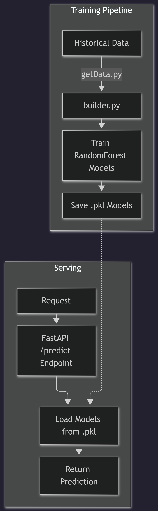

# AI Prediction Engine

This directory contains the machine learning components for the IoT weather station project. It uses historical sensor data to train models and provides an API to predict future weather conditions.

## Architecture Diagram


## Setup/Installation
1. Ensure Python is installed.
2. Install dependencies:
   ```bash
   pip install -r requirements.txt
   ```

## Environment Variables
Create an `.env` file in this directory based on the configuration defined in `../docs/ENVIRONMENT_VARIABLES.md`.

## Key Files/Logic
- `main.py`: FastAPI application that loads the pre-trained models upon startup and exposes a `/predict` endpoint.
- `builder.py`: Main script for fetching data, training the `RandomForestRegressor` models, and saving them.
- `getData.py`: Utility module for querying the backend API.
- `models/`: Directory where trained model artifacts (`.pkl`) are stored.
- `requirements.txt`: Python dependencies.
- `test.py`: Testing script for verification.

## Useful Commands
- **Train Models:** `python builder.py`
- **Start API:** `uvicorn main:app --reload`
- **API Endpoint:** **POST** `/predict` (expects `features` list and `type` string)

