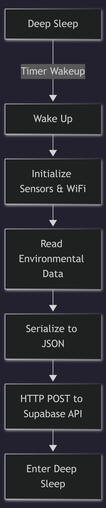

# ESP32 Firmware

This directory contains the firmware for the ESP32-based weather station and related hardware documentation.

## How It Works
- **Sensor Reading:** The ESP32 wakes up from deep sleep, initializes sensors (BMP280, SGP40, DHT11, HW-486), reads environmental data, and calculates values.
- **Data Transmission:** The data is serialized to JSON and sent via an HTTP POST request to the Supabase endpoint.
- **Power Management:** After transmitting data, the ESP32 enters deep sleep for a configurable amount of time (15 minutes) to conserve power, then cycles again.

## Folder Layout
- `weather_station.ino`: Main Arduino firmware.
- `Schematic.png`: Wiring diagram for the sensor array.
- `3D Prints`: STL Files used for 3D printing the enclosure.

## Needed Libraries
- Wire.h
- WiFi.h
- HTTPClient.h
- WiFiClient.h
- ArduinoJson.h
- DHT.h
- Adafruit_BMP280.h
- Adafruit_SGP40.h

## Circuit Diagram

## 3D Prints

The case was 3D-printed using white PLA filament. Total print time was about 6 hours 55 minutes using an Ender 3 V2.

| Dimension | Length (mm)
| --- | ---
| Outer width | 95
| Outer length | 70
| Wall thickness | 5
| Inner width | 85
| Inner length | 60
| Slot in holes type 1 length | 10
| Slot in holes type 1 width | 5
| Slot in holes type 2 length | 15
| Slot in holes type 2 width | 5

Cover measurements

| Dimension | Length (mm)
| --- | --- 
| Width | 85
| Length | 60
| Slot in protrusion type 1 length | 10
| Slot in protrusion type 1 width | 5
| Slot in protrusion type 2 length | 15
| Slot in protrusion type 2 width | 5
| Vent length | 55
| Vent width | 3
| BMP 280 Hole Width | 17
| BMP 280 Hole Length | 13
| DHT11 Hole Width | 13
| DHT11 Hole Length | 20
| SGP40 Hole Width | 15
| SGP40 Hole Length | 12
| HW-486 Hole Width | 21
| HW-486 Hole Length | 17 

## Hardware Components
- ESP32
- Sensors: BMP280 (Temperature/Pressure), SGP40 (VOC), DHT11 (Temp/Humidity), HW-486 (Light Intensity).

## Setup
1. Open `weather_station.ino` in the Arduino IDE.
2. Configure Wi-Fi credentials (`ssid`, `password`) and Supabase endpoints (`supabase_url`, `anon_key`).
3. Flash the firmware to your ESP32 board.

## Flowchart

