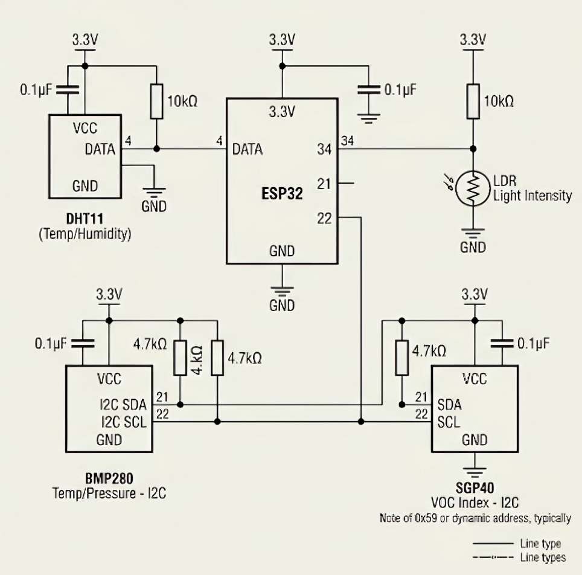

# IoT Weather Station

The IoT Weather Station is a comprehensive project that monitors environmental conditions using an ESP32-based hardware setup. It captures data (temperature, humidity, pressure, light, VOCs), stores it in a Supabase database, and presents real-time analytics through a responsive React dashboard. The system also features machine learning capabilities to predict future weather patterns based on historical data.

## Table of Contents
- [Features](#features)
- [Project Structure](#project-structure)
- [Requirements](#requirements)
- [Setup](#setup)
- [Hardware Details](#hardware-details)
- [Configuration](#configuration)
- [Run Locally](#run-locally)
- [API & Routes](#api-and-routes)
- [Architecture](#architecture)
- [Production Build](#production-build)
- [Troubleshooting](#troubleshooting)

## Features

- Displays humidity, pressure, temperature, light intensity, and VOC readings
- Reads sensor data from Supabase through an Express API
- Responsive React dashboard styled with Tailwind CSS
- About page with project information and device artwork
- Helmet security headers, CORS, and API rate limiting

## Project Structure

```text
.
├── backend/          # Express API for data retrieval and AI prediction
│   ├── src/          # Source code
│   └── .env          # Environment configuration
├── frontend/         # React + Vite dashboard for data visualization
│   ├── src/          # React components and logic
│   ├── flowchart.mmd # Project architecture diagram
│   └── .env          # Environment configuration
├── ESP32/            # Hardware design and firmware
│   ├── *.ino         # ESP32 firmware source code
│   ├── *.stl         # 3D model files for the weather station case
│   └── schematic.svg # Hardware circuit diagram
└── README.md         # Project documentation
```

## Requirements

- Node.js 18 or newer
- npm
- A Supabase project with a `sensor` table

## Setup

Install dependencies in both applications:

```bash
cd backend
npm install

cd ../frontend
npm install
```

## Hardware Details

### Schematic Diagram



### Case specifications

The case was 3D-printed using white PLA filament. Total print time was about 6 hours 55 minutes using an Ender 3 V2.

| Dimension | Length (mm)
| --- | ---
| Outer width | 95
| Outer length | 70
| Wall thickness | 5
| Inner width | 85
| Inner length | 60
| Slot in holes type 1 length | 10
| Slot in holes type 1 width | 5
| Slot in holes type 2 length | 15
| Slot in holes type 2 width | 5

Cover measurements

| Dimension | Length (mm)
| --- | --- 
| Width | 85
| Length | 60
| Slot in protrusion type 1 length | 10
| Slot in protrusion type 1 width | 5
| Slot in protrusion type 2 length | 15
| Slot in protrusion type 2 width | 5
| Vent length | 55
| Vent width | 3
| BMP 280 Hole Width | 17
| BMP 280 Hole Length | 13
| DHT11 Hole Width | 13
| DHT11 Hole Length | 20
| SGP40 Hole Width | 15
| SGP40 Hole Length | 12
| HW-486 Hole Width | 21
| HW-486 Hole Length | 17 

STL files are `ESP32/cover.stl` and `ESP32/outerCase.stl`.

## Configuration

### Backend environment

Create `backend/.env`:

```env
supabaseURL=https://your-project.supabase.co
supabaseKey=your-supabase-key
ORIGIN=http://localhost:5173
```

The API reads the following columns from the `sensor` table:
- `created_at`, `humidity`, `pressure`, `temperature`, `light_intensity`, `voc_index`

### Frontend environment

Create `frontend/.env`:

```env
VITE_BACKEND_URL=http://localhost:3000
```

## Run Locally

Start the backend in one terminal:
```bash
cd backend
npm run dev
```

Start the frontend in a second terminal:
```bash
cd frontend
npm run dev
```

Open the URL printed by Vite, usually `http://localhost:5173`.

## API & Routes

### Routes
| Route | Description |
| --- | --- |
| `/` | Live sensor dashboard |
| `/about` | Project overview |

### API (`GET /getData`)
Returns sensor readings from Supabase:

```json
{
  "data": [],
  "ok": true
}
```

The backend listens on port `3000` by default.

## Architecture

```text
Supabase sensor table
       |
       v
Express GET /getData  -->  React dashboard
       |
  CORS + Helmet + rate limiting
```

The frontend requests the API when the dashboard loads. The backend returns an object containing `data` and an `ok` status flag.

## Production Build

Build the frontend:
```bash
cd frontend
npm run build
```

Preview the production build:
```bash
npm run preview
```

## Troubleshooting

- If the dashboard shows no readings, confirm that the backend is running on port `3000` and that `VITE_BACKEND_URL` matches it.
- If the backend cannot connect to Supabase, check `supabaseURL` and `supabaseKey` in `backend/.env`.
- Restart the Vite dev server after changing frontend environment variables.
