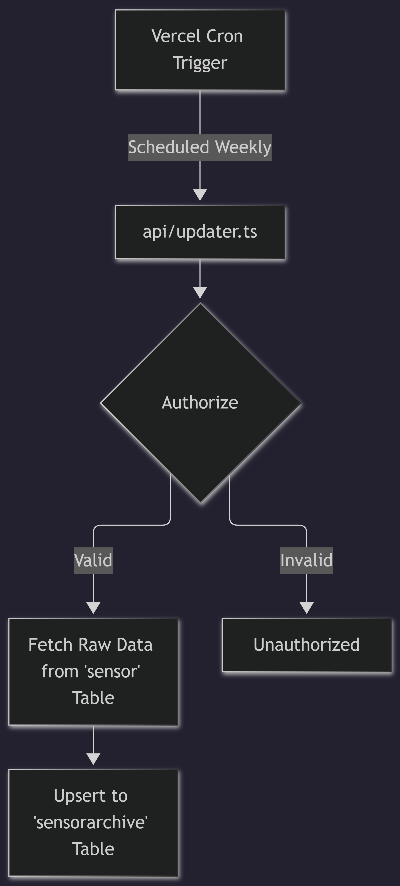

# Data Archiver

Handles the archiving of raw weather data from Supabase to a secondary storage (`sensorarchive` table) for long-term retention.

## Functionality
- **Tech Stack:** Built with Node.js, TypeScript, and Supabase.
- **How the Cron Works:**
  - A serverless function located at `api/updater.ts` contains the logic to fetch raw data from the `sensor` table and upsert it into the `sensorarchive` table.
  - This function is triggered automatically via Vercel's Cron service, as configured in `vercel.json` (`schedule: "0 0 * * 0"`, which runs at midnight every Sunday).
  - The function validates a `CRON_SECRET` in the authorization header to ensure secure execution.

## Flowchart
