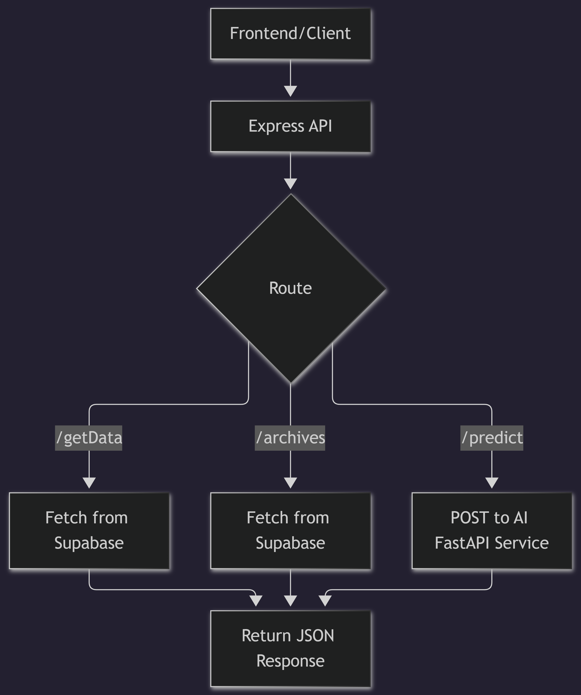

# Backend API

Express.js API that bridges the ESP32 sensors and the frontend dashboard using Supabase as the data store.

## Architecture Diagram


## Setup/Installation
1. Install dependencies:
   ```bash
   npm install
   ```

## Environment Variables
Create an `.env` file in this directory based on the configuration defined in `../docs/ENVIRONMENT_VARIABLES.md`.

## Key Files/Logic
- Provides endpoints for frontend and AI services.
- Implements security headers (Helmet), CORS, and rate limiting.

## Useful Commands
- **Run Development:** `npm run dev`

## API Documentation
Refer to `../docs/API.md` for detailed information on endpoints, payloads, and responses.

## Database Schema
- Expects a `sensor` table with columns: `created_at`, `humidity`, `pressure`, `temperature`, `light_intensity`, `voc_index`.
- Expects a `sensorarchive` table for historical data.

