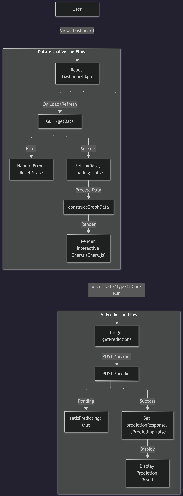

# Weather Station Dashboard

A responsive React-based dashboard designed to visualize real-time environmental data collected by the IoT weather station.

## Architecture Diagram


## Setup/Installation
1. Install dependencies:
   ```bash
   npm install
   ```

## Environment Variables
Create an `.env` file in this directory based on the configuration defined in `../docs/ENVIRONMENT_VARIABLES.md`.

## Key Files/Logic
- **Tech Stack:** Built with React, Vite, TypeScript, and Tailwind CSS.
- **Data Visualization:** Uses `Chart.js` for rendering interactive line graphs.
- **Structure:**
  - `src/components/App.tsx`: Main entry point.
  - `src/components/Chart.tsx`: Reusable `Chart.js` wrapper.
  - `src/components/About.tsx` & `src/components/Github.tsx`: Informational components.

## Useful Commands
- **Run Development:** `npm run dev`
